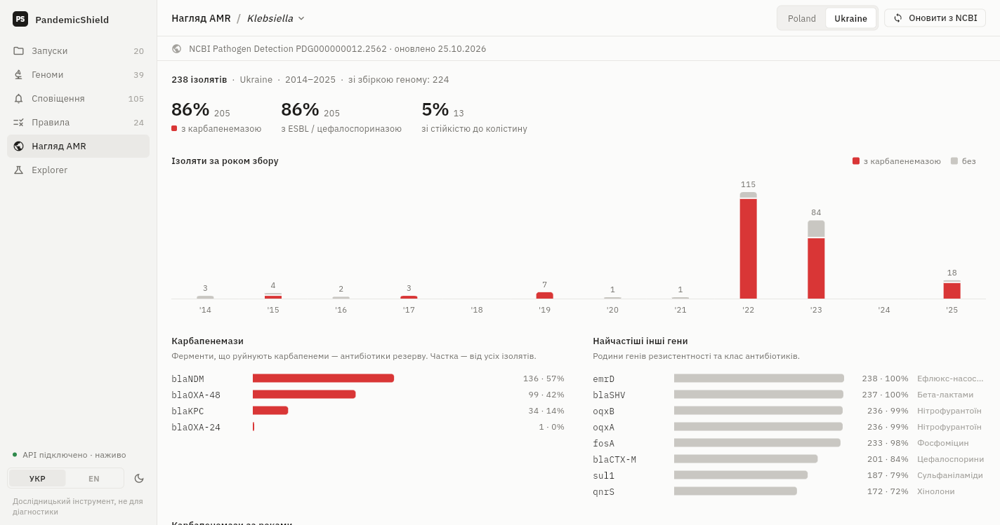
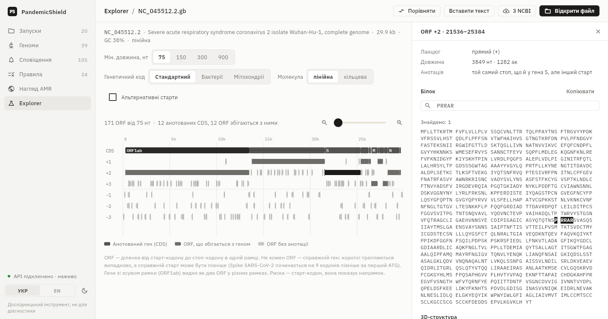
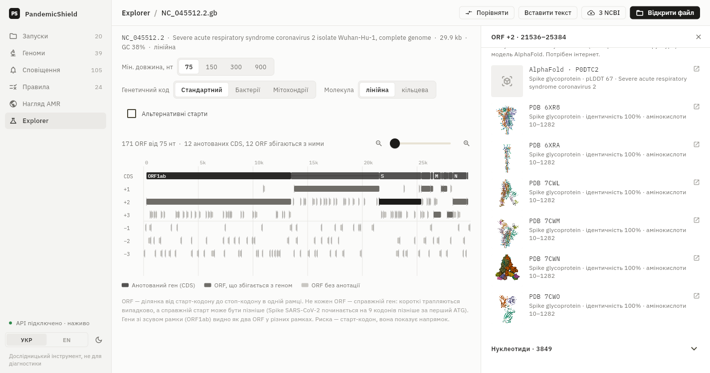
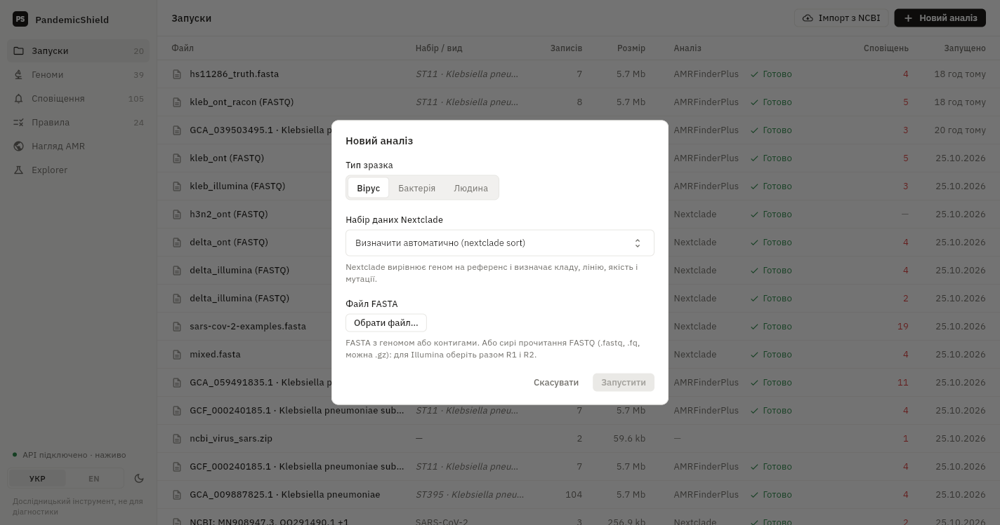
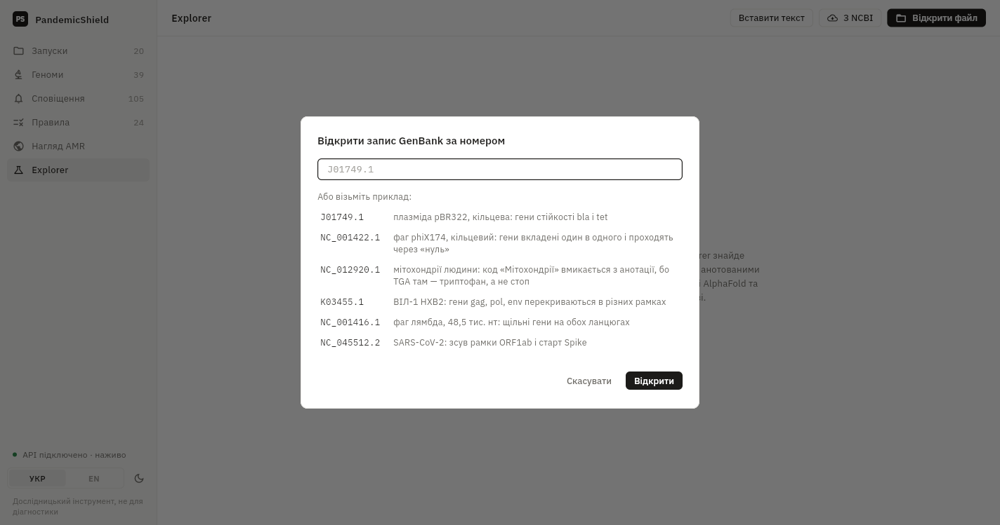
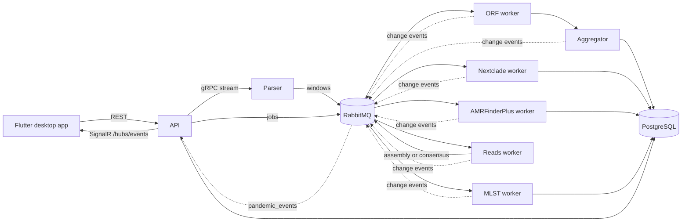

# 🧬 Pandemic Shield: genomic surveillance on your own machine


**Pandemic Shield** is a self-hosted, event-driven platform for viral and bacterial genomic surveillance with a desktop app in Ukrainian and English.
Drop in a genome or raw sequencer reads and it tells you what it is, which variant or strain, which mutations and resistance genes it carries, and raises alerts on the rules you define.
Everything runs offline on your machine. Only NCBI import and 3D structure lookup need the internet.

| You have | You get |
|---|---|
| Viral genomes (FASTA): SARS-CoV-2, influenza, RSV, mpox, even mixed in one file | Clade, Pango lineage, QC, coverage, every mutation ([Nextclade](https://docs.nextstrain.org/projects/nextclade/), dataset picked per sequence by `nextclade sort`) |
| Bacterial assemblies (FASTA) | Resistance genes and point mutations per antibiotic group ([NCBI AMRFinderPlus](https://www.ncbi.nlm.nih.gov/pathogens/antimicrobial-resistance/AMRFinder/)), sequence type (MLST, e.g. *K. pneumoniae* ST147) |
| Raw reads (FASTQ) from Illumina or Oxford Nanopore | A consensus genome for viruses or an assembly for bacteria (SKESA, or Flye polished with Racon), then the same analysis |
| Nothing at all | Up to 500 NCBI accessions or an NCBI Datasets archive imported in one go, and a dashboard of antimicrobial resistance in Ukraine from NCBI Pathogen Detection |
| A GenBank record or just an accession | **Explorer**, a learning mode: ORFs in 6 frames next to the annotated genes, protein, motif search, 3D structures from PDB and AlphaFold, pairwise alignment |

Every sample can be exported as a PDF or CSV report with database versions for reproducibility, and the app updates live over SignalR.

> ⚠️ Pandemic Shield is a research and educational tool. It is **not** a medical device and must not be used for diagnosis. A resistance gene is a prediction, not an antibiogram.

---

## 📸 Interface


> *Genomes: seven SARS-CoV-2 variants from one file. Clade (coloured chronologically, like Nextstrain), dataset chosen automatically, Pango lineage, QC, coverage, a mutation bar per genome and the rules that fired.*


> *Genome detail: matched rules (Delta, `S:L452R`, `S:P681R`), the genome map with alert labels, protein changes grouped by gene.*


> *Bacterial isolate from NCBI: hypervirulent *K. pneumoniae* ST23 carrying NDM-1 and OXA-48. MLST profile, predicted resistance per antibiotic group, and the rule for a high-risk clone.*



> *AMR surveillance from NCBI Pathogen Detection: 238 Ukrainian Klebsiella isolates, 86% with a carbapenemase (NDM, OXA-48, KPC), by year, gene, region and source. One click imports and analyses any isolate.*



> *Explorer: SARS-CoV-2 opened by accession. ORFs in six frames under the annotated genes. The Spike ORF starts 9 codons before the real start, and the furin site `PRRAR` is found by a motif search.*



> *Explorer: 3D structures for the selected protein from RCSB PDB (sequence search) and the AlphaFold DB model with its pLDDT.*

| Runs | New analysis | Explorer: open by NCBI accession |
|---|---|---|
|  |  |  |

| Alerts | Rules | Dark theme, English |
|---|---|---|
|  |  |  |

The UI follows a written design system ([`docs/DESIGN.md`](docs/DESIGN.md)) modelled on Linear, Vercel Geist and Nextclade Web.

---

## ✨ Features

**Viruses**
* **Nextclade, offline:** clade, Pango lineage, QC and all mutations per genome. Datasets are baked into the image: SARS-CoV-2, influenza H1N1pdm and H3N2 HA, RSV-A/B, mpox. The dataset version is stored, so any sample can be re-run with a newer dataset or new rules.
* **Automatic dataset choice:** `nextclade sort` assigns every sequence its own dataset, so different viruses can share one FASTA. Unrecognised sequences are flagged instead of failing the run.
* **Variant rules and alerts:** `S:N501Y`, `S:E484` (any change), `S:F157-`, `A23403G`, `clade:Delta`, `lineage:BA.2.86*` (descendants are resolved through Pango aliases).

**Bacteria**
* **Antimicrobial resistance (AMRFinderPlus 4.2.7):** genes and species-specific point mutations, predicted resistance per antibiotic group, rules such as `subclass:CARBAPENEM` or `gene:blaKPC*`.
* **MLST (`mlst` 2.35.0, PubMLST schemes):** sequence type and allele profile, with rules for high-risk clones (`st:klebsiella/147`). A tie between schemes is broken by assembly GC content.

**Raw reads (FASTQ)**
* **Viruses:** minimap2 maps the reads to the references of every installed Nextclade dataset, the best match is chosen, and `samtools consensus` builds the genome.
* **Bacteria:** fastp + SKESA for Illumina; Flye + two rounds of Racon polishing for Nanopore.
* Read count, mapping rate, depth or N50 go into the run and the PDF report.

**Open data**
* **Bulk NCBI import:** up to 500 accessions (`OQ291490.1`, `GCA_009887825.1`) or an NCBI Datasets / NCBI Virus ZIP. Viral sequences become one run. Each bacterial assembly becomes its own run, with the species taken from NCBI metadata.
* **AMR surveillance dashboard:** NCBI Pathogen Detection files (up to ~830 MB) are streamed and filtered by country (Ukraine by default, compare with neighbours). The dashboard shows isolates per year with and without a carbapenemase, carbapenemase families, gene × year heatmap, regions and sources.

**Explorer (learning mode)**
* Open FASTA or GenBank, paste text, or type an NCBI accession; examples include a plasmid, phage phiX174, the human mitochondrion, HIV-1, phage lambda and SARS-CoV-2.
* ORF map in 6 frames next to the GenBank annotation, with zoom, circular molecules (ORFs crossing the origin) and the genetic code taken from `/transl_table`.
* Protein view with motif search; 3D structures from RCSB PDB and AlphaFold DB.
* Pairwise alignment (affine-gap Gotoh, BLOSUM62 for proteins): an ORF against its annotated gene, two records, or two pasted sequences.

**Everywhere**
* **Cross-sample search:** which genomes carry `S:E484K`? Which isolates carry `blaNDM`? Which are ST147?
* **Reports:** PDF (Ukrainian / English, with database versions) and CSV with stable columns.
* **Live updates:** SignalR pushes changes to the app in about 2 s; polling is only a fallback.
* **Desktop app:** Ukrainian / English, light / dark theme, bundled IBM Plex fonts.

---

## ⚙️ Architecture



| Service | What it does |
|---|---|
| **API** (ASP.NET Core minimal APIs) | Uploads, REST endpoints, NCBI import, Explorer sessions, reports, SignalR hub that relays change events |
| **Parser** (gRPC) | Receives the uploaded file as a stream, parses FASTA records and publishes overlapping windows |
| **Worker** | Finds ORFs in 6 frames and scans proteins for motifs (`PandemicShield.Bio`) |
| **Aggregator** | Stores ORF motif findings |
| **Nextclade** | `nextclade sort` + `nextclade run` with baked-in datasets, stores results and evaluates variant rules |
| **AMRFinderPlus** | Runs AMRFinderPlus inside the official `ncbi/amr` image; also streams NCBI Pathogen Detection for the dashboard |
| **MLST** | Runs `mlst` inside `staphb/mlst:2.35.0` |
| **Reads** | minimap2 2.28, samtools 1.21, fastp 0.24.0, SKESA 2.5.1, Flye 2.9.5, Racon 1.5.0, seqkit 2.9.0 |
| **RabbitMQ, PostgreSQL** | Queues and the `pandemic_events` fanout exchange; EF Core migrations |

`PandemicShield.Bio` is the dependency-free biological core: streaming FASTA and GenBank readers, IUPAC codes, NCBI genetic code tables, 6-frame and circular ORF search, motif scanner and pairwise alignment. It has golden tests on the SARS-CoV-2 reference genome.

### Big files, small memory
A large `.fasta` can exceed **3 GB**. The API never loads it into memory: it streams the file in **32 KB chunks** over gRPC to the Parser. The Parser reads FASTA records on the fly (headers, line breaks, case, IUPAC codes) and cuts them into overlapping windows, so nothing is lost at chunk boundaries. Windows go through RabbitMQ with backpressure to workers that run in parallel, so memory use stays bounded however big the file is.

---

## 🚀 Getting started

### Prerequisites
* Docker Desktop (Windows / macOS) or Docker Engine + Compose. Give Docker at least 6 GB of RAM (10 GB to assemble bacteria from FASTQ) and keep **~15 GB of free disk** for images.
* Flutter SDK for the desktop app.
* .NET 10 SDK to run the tests.

### Backend
```bash
docker compose up --build -d
```
The API listens on `http://localhost:5020`, and the RabbitMQ UI is at `http://localhost:15672` (guest / guest).
All 10 containers wait for PostgreSQL and RabbitMQ to be healthy and restart together with Docker Desktop.

> The first build downloads Nextclade 3.24.0 with its datasets, the `ncbi/amr` and `staphb/mlst` images and the read tools from bioconda, so it needs internet access once. After that, analysis runs offline. Uploaded files are kept in the `run_data` volume so samples can be re-analysed. Database data lives in the Postgres container, so `docker compose down` resets it.

### Desktop app
```bash
cd pandemic_shield_desktop
flutter run -d windows   # or macos / linux
```

### Tests
```bash
dotnet test PandemicShield.slnx   # 210 tests: Bio core, Nextclade, AMRFinderPlus, MLST, FASTQ, NCBI import, surveillance, reports, Explorer
```

---

## 🧪 Try it

| Input | How | What you should see |
|---|---|---|
| `PandemicShield.Nextclade.Tests/Data/sars-cov-2-examples.fasta` | New analysis → Virus, dataset "Detect automatically" | 7 real genomes (Alpha, Beta, Delta, BA.2, JN.3.3, EG.5.1, JF.4) and one too-short sequence; 13 alerts, e.g. Delta: `Delta`, `S:L452R`, `S:P681R` |
| `PandemicShield.Nextclade.Tests/Data/sort/mixed.fasta` | Same | SARS-CoV-2, influenza H3N2 and RSV-A in one file, each with its own dataset |
| `PandemicShield.AmrFinder.Tests/Data/kpneumoniae-demo.fasta` | Bacterium, *Klebsiella pneumoniae* | NDM-1, OXA-48, CTX-M-15: resistance to carbapenems and cephalosporins, 3 alerts |
| NCBI accessions, e.g. `GCA_059491835.1` | Runs → Import from NCBI, type Bacterium | Hypervirulent ST23 with NDM-1 and OXA-48 |
| AMR surveillance | Update from NCBI, group *Klebsiella*, country Ukraine | ~240 isolates, ~86% with a carbapenemase |
| Simulated reads | `python docs/scripts/simulate_reads.py genome.fasta sample --platform illumina --depth 200` (or `nanopore --depth 30`), then New analysis → FASTQ | The consensus reproduces the genome's mutations; a bacterial assembly gives its genes and ST |
| Explorer | From NCBI → `NC_045512.2`, `J01749.1`, `NC_012920.1`… | Spike start and the ORF1ab frameshift, plasmid genes on both strands, mitochondrial code |

The legacy ORF motif scan can be checked with `python3 docs/scripts/make_test_fasta.py > mutant.fasta` (category Virus). It gives exactly 4 findings (Delta and D614G on both strands), while the unmodified `MN908947.fasta` gives none.

---

## 📚 Documentation
* [`docs/GETTING_STARTED.md`](docs/GETTING_STARTED.md): running it, where to get genomes and reads, what is feasible at home.
* [`docs/DOMAIN_GUIDE.md`](docs/DOMAIN_GUIDE.md): biology primer (DNA, codons, ORFs, mutations, file formats) and how it maps to the code.
* [`docs/DIRECTION.md`](docs/DIRECTION.md): where the project is going and why.
* [`docs/STAGE2_NEXTCLADE.md`](docs/STAGE2_NEXTCLADE.md): Nextclade, variant rules and the UI.
* [`docs/STAGE3_AMR.md`](docs/STAGE3_AMR.md): bacterial resistance with AMRFinderPlus.
* [`docs/STAGE4_DATA.md`](docs/STAGE4_DATA.md): NCBI import, AMR surveillance, MLST and reports.
* [`docs/STAGE5_READS_EXPLORER.md`](docs/STAGE5_READS_EXPLORER.md): `nextclade sort`, SignalR, FASTQ (with checks against a known genome) and Explorer.
* [`docs/BIOLOGY_REVIEW.md`](docs/BIOLOGY_REVIEW.md): biological audit of the original implementation.
* [`docs/DESIGN.md`](docs/DESIGN.md): the design system behind the desktop UI.

---

## 🔮 Known limitations and roadmap

* **MLST is coarse for outbreaks.** ST11 is found worldwide. Saying "the same strain in two hospitals" needs genome-to-genome distance (SNP or cgMLST), which is the next big step. Klebsiella-specific typing (Kleborate: virulence, capsule) is also missing.
* **Gene ≠ phenotype.** AMRFinderPlus predicts resistance; clinical decisions need a lab susceptibility test. Without a species, point mutations are not searched (the app suggests one from MLST).
* **Nanopore assemblies are polished with Racon, not Medaka.** Racon fixes base errors but not assembly structure: a duplicated region can still yield an extra gene copy. Short-read (SKESA) assemblies, on the other hand, collapse repeated genes to one copy.
* **The read simulator is for testing only.** Real sequencing errors are more complex.
* **Surveillance data is what labs chose to publish.** NCBI Pathogen Detection is not a representative sample of a country; the dashboard says so.
* **ORF ≠ gene.** Frameshifts, introns and real start sites come from annotation, not ORF search. Explorer shows this on purpose.
* **Motif matching is simplified.** Exact amino-acid motifs miss synonymous changes and break when another mutation sits inside the motif. Use Nextclade rules for surveillance.
* **Single machine, single user.** There is no authentication or audit log yet.
* **No CI yet.** Tests and image builds run by hand; GitHub Actions is the first item of the roadmap.
