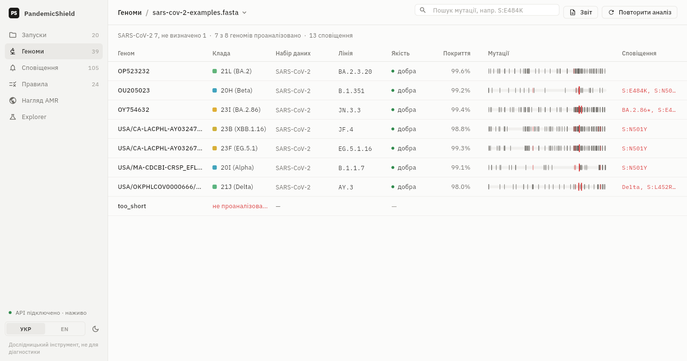
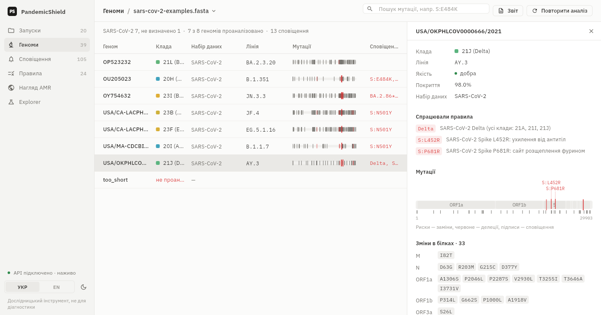
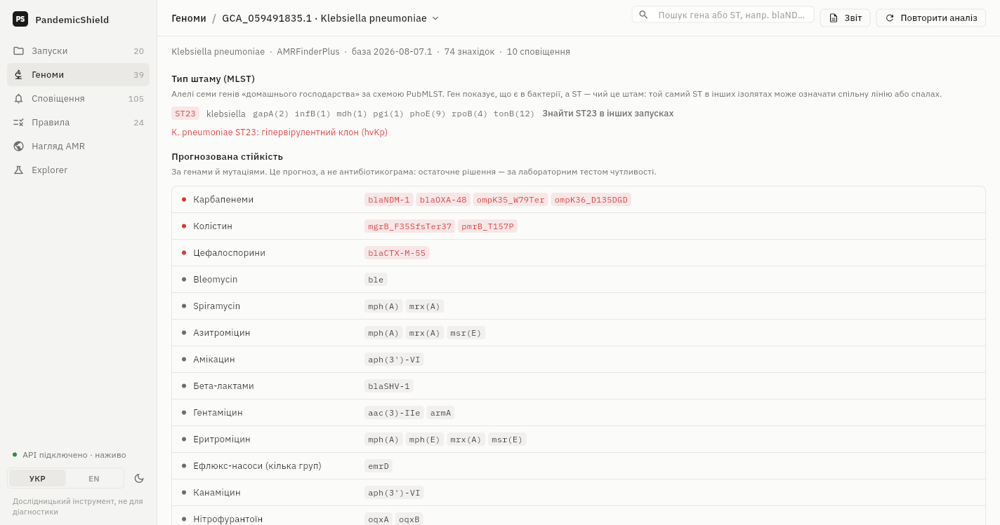
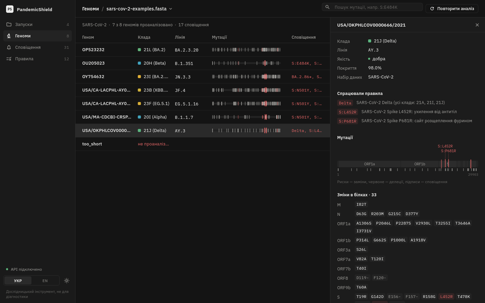
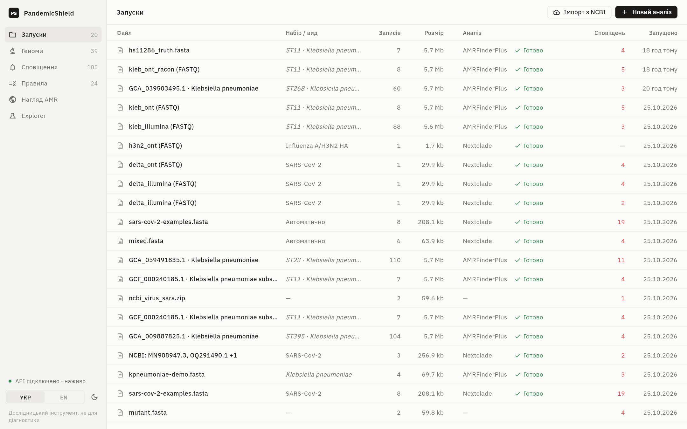
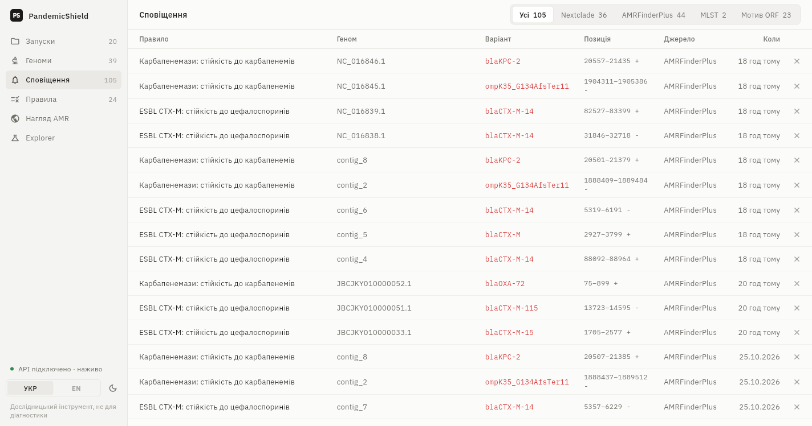
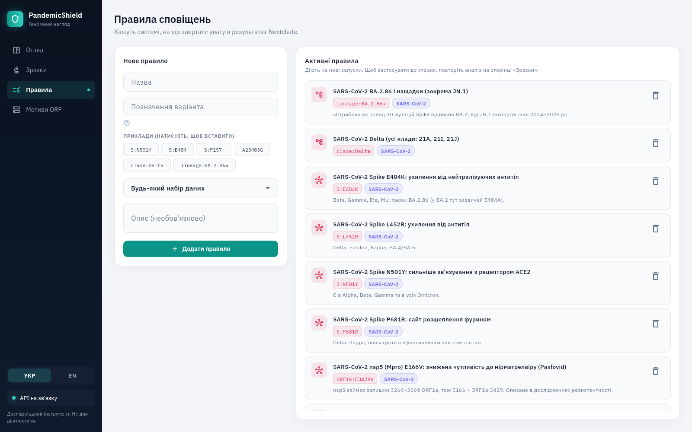

# 🧬 Pandemic Shield - Bio-Security DNA Analysis System


**Pandemic Shield** is an event-driven, self-hosted platform for viral genomic surveillance. Upload `.fasta` genomes and it runs [Nextclade](https://docs.nextstrain.org/projects/nextclade/) offline to assign clades and Pango lineages, check sequence quality and call every mutation; it keeps the history of your samples, lets you search a mutation across all of them and raises alerts on the variants you define (e.g. `S:E484K`, `clade:Delta`, `lineage:BA.2.86*`). For bacterial genome assemblies it runs [NCBI AMRFinderPlus](https://www.ncbi.nlm.nih.gov/pathogens/antimicrobial-resistance/AMRFinder/) offline to find antimicrobial resistance genes and point mutations (e.g. carbapenemases such as NDM and OXA-48) and summarises the predicted resistance per antibiotic group, and types the strain with MLST (e.g. *K. pneumoniae* ST147). Open NCBI data is a first-class input: import up to 500 accessions or an NCBI Datasets archive at once, and follow antimicrobial resistance in Ukraine on a dashboard built from NCBI Pathogen Detection. Raw reads are accepted too: Illumina or Nanopore FASTQ becomes a viral consensus genome or a bacterial assembly (SKESA, Flye). Mixed files are fine: `nextclade sort` picks the right dataset for every sequence. The app updates live over SignalR. Every sample can be exported as a PDF or CSV report. The Explorer tab is a learning mode: open a FASTA or GenBank file, see ORFs in 6 frames next to the annotated genes, translate one, search a motif, find its 3D structure in PDB and AlphaFold, and align two sequences. The desktop app speaks Ukrainian and English.

---

## 📸 System Interface



> *Genomes: clade (coloured chronologically, like Nextstrain), Pango lineage, QC, coverage, a per-genome mutation bar (like Nextclade's sequence view) and matched rules.*



> *Genome detail in a side panel: matched rules, genome map with alert labels, protein changes grouped by gene.*



> *Bacterial isolate: predicted resistance per antibiotic group (AMRFinderPlus) and all findings with resistance / stress / virulence filters.*



> *Dark theme and English UI.*

| Runs | Alerts | Rules |
|---|---|---|
|  |  |  |

The UI follows a written design system ([`docs/DESIGN.md`](docs/DESIGN.md)) modelled on Linear, Vercel Geist and Nextclade Web.

---

## 🏗️ The Engineering Challenge & Solution

### The Problem: Memory Overload with Big Data
A standard human genome or large viral dataset `.fasta` file can exceed **3 GB** in plain text. Loading this directly into server RAM using traditional HTTP POST requests causes `OutOfMemoryException` and crashes standard monolithic backends.

### The Solution: Streaming & Event-Driven Architecture
This project implements a highly scalable pipeline to process gigabytes of data using a strict **4 GB RAM constraint** via Docker containers.

1. **gRPC Streaming:** The API ingests the massive file and immediately streams it in **32 KB chunks** via gRPC to the Parser service.
2. **Backpressure & Queuing:** The Parser translates the chunks into DTOs and publishes them to **RabbitMQ**. A deliberate backpressure mechanism (artificial delay) is implemented to prevent the message broker from flooding, balancing the ingestion rate with the processing rate.
3. **Record-aware windows:** The Parser parses FASTA records on the fly (headers, line breaks, case and IUPAC codes are handled) and cuts each record into overlapping windows, so nothing is lost at chunk boundaries and memory stays bounded.
4. **Distributed Workers:** Worker nodes consume windows asynchronously, find Open Reading Frames in all **6 reading frames** (both DNA strands) and scan the translated proteins against a PostgreSQL dictionary using Entity Framework Core.

---

## ⚙️ Architecture Diagram

### Microservices Breakdown:
* **API Gateway (ASP.NET Core Minimal APIs):** Handles HTTP Multipart file uploads and serves REST endpoints for the Flutter frontend.
* **Parser Service (gRPC):** Receives the binary stream, chunks the data, and publishes `DnaChunkMessage` events.
* **Nextclade worker (`PandemicShield.Nextclade`):** Consumes `nextclade_jobs`, runs the Nextclade CLI offline against datasets baked into its image (SARS-CoV-2, influenza H1N1pdm/H3N2 HA, RSV-A/B, mpox), stores per-genome clade, lineage, QC and mutations, and evaluates variant rules into alerts.
* **AMRFinderPlus worker (`PandemicShield.AmrFinder`):** Consumes `amrfinder_jobs`, runs NCBI AMRFinderPlus 4.2.7 inside the official `ncbi/amr` image (database bundled, offline), stores resistance/stress/virulence findings and evaluates gene/class rules into alerts.
* **Bio library (`PandemicShield.Bio`):** Dependency-free biological core: streaming FASTA reader, IUPAC nucleotides, NCBI genetic code tables, overlapping windows, 6-frame ORF finder, protein motif scanner. Covered by golden tests on the SARS-CoV-2 reference genome.
* **MLST worker (`PandemicShield.Mlst`):** Consumes `mlst_jobs`, runs Torsten Seemann's `mlst` inside `staphb/mlst:2.35.0` (PubMLST schemes bundled, offline) and alerts on high-risk clones (`st:klebsiella/147`).
* **NCBI import (in the API):** A hosted service consumes `import_jobs` and turns accession lists (E-utilities, Datasets API v2) or Datasets ZIPs into ordinary runs.
* **Surveillance (in the AMRFinderPlus worker):** Streams NCBI Pathogen Detection `amr.metadata.tsv` files (up to ~830 MB), keeps isolates from the chosen countries and classifies their genes with the AMRFinderPlus database.
* **Worker Service (.NET Worker):** Subscribes to RabbitMQ and runs the Bio library on each window (`MutationScannerService`).
* **Aggregator/DB Context:** EF Core implementation over PostgreSQL to store dictionaries and threat logs.
* **Reads worker (`PandemicShield.Reads`):** Consumes `reads_jobs`: minimap2 + samtools consensus for viruses, fastp + SKESA (Illumina) or Flye (Nanopore) for bacteria, then hands the genome to the normal pipeline.
* **Live updates:** every service publishes change events to the RabbitMQ fanout exchange `pandemic_events`; the API relays them to the SignalR hub `/hubs/events`.
* **Frontend (Flutter Desktop):** A modern, clinical-themed desktop app that refreshes on SignalR events (polling only as a fallback).

---

## ✨ Key Features

* **Zero-Memory-Bloat Processing:** Safely handles 3GB+ files on constrained hardware.
* **Open Reading Frame (ORF) Detection:** 6-frame search (forward + reverse complement), longest ORF per stop codon like NCBI ORFfinder, nested/overlapping ORFs, minimum length, NCBI genetic code tables 1/2/4/11.
* **Nextclade analysis:** Clade, Pango lineage, QC and all mutations per genome, with dataset version stored for reproducibility; re-run any stored sample with a newer dataset or new rules.
* **Variant rules:** `S:N501Y`, `S:E484` (any change), `S:F157-`, `A23403G`, `clade:Delta`, `lineage:BA.2.86*` (with descendants through Pango aliases).
* **Bacterial resistance (AMRFinderPlus):** resistance genes and species-specific point mutations, predicted resistance per antibiotic group, rules such as `subclass:CARBAPENEM` or `gene:blaKPC*`.
* **Cross-sample search:** which genomes in all runs carry `S:E484K`? Which isolates carry `blaNDM`? Which are ST147?
* **Bulk import of open NCBI data:** up to 500 accessions (`OQ291490.1`, `GCA_009887825.1`) or an NCBI Datasets / NCBI Virus ZIP. Viral sequences become one run; every bacterial assembly becomes its own run with the species taken from NCBI metadata.
* **Automatic dataset choice:** `nextclade sort` assigns every sequence its own dataset, so SARS-CoV-2, influenza and RSV can share one FASTA.
* **Raw reads (FASTQ):** Illumina or Nanopore reads in, consensus genome or assembly out, with read and coverage stats in the report.
* **Explorer:** ORF map in 6 frames with GenBank annotations and circular plasmids, protein and motif view, RCSB PDB and AlphaFold DB structures, pairwise alignment.
* **AMR surveillance dashboard:** NCBI Pathogen Detection for a bacterial group and country (Ukraine by default): isolates per year with and without carbapenemases, carbapenemase families, gene × year heatmap, regions, sources, and one click to import and analyse any isolate yourself.
* **MLST sequence typing:** ST, PubMLST scheme and allele profile for every bacterial run; rules such as `st:klebsiella/147`.
* **Sample reports:** PDF (Ukrainian / English, with database versions for reproducibility) and CSV (stable columns for spreadsheets and scripts).
* **Desktop UI:** Ukrainian / English, light / dark theme, bundled IBM Plex fonts, per-genome mutation bars and genome map.
* **Genomic coordinates:** Findings are reported as `record:start-end (strand)`, 1-based like NCBI/GenBank, and linked to an analysis run (sample).
* **Live Sync UI:** Flutter desktop app automatically polls and renders detected threats in real-time without locking the UI thread.
* **Dynamic Threat Dictionary:** Full CRUD capabilities; workers reload the dictionary every 15 seconds, no restart needed.
* **Dockerized Environment:** One-command deployment `docker-compose up --build` spins up all services, RabbitMQ, and PostgreSQL.

---

## 🚀 Getting Started (Local Development)

### Prerequisites
* Docker Desktop
* Flutter SDK (for desktop compilation)
* .NET SDK 

### Running the Backend
1. Clone the repository.
2. Navigate to the root folder where `docker-compose.yml` is located.
3. Run the following command to spin up the cluster:
   ```bash
   docker-compose up --build -d
   ```
4. The API will be available at `http://localhost:5020`

> The first build of the `nextclade` and `amrfinder` services downloads Nextclade 3.24.0 with its datasets and the `ncbi/amr` image (~400 MB, AMRFinderPlus with its database), so it needs internet access once; after that analysis runs fully offline. Uploaded files are kept in the `run_data` Docker volume so samples can be re-analysed.

> **Upgrading from an older version:** the database schema is now managed by EF Core migrations.
> If you ran the previous version, reset the database once with `docker-compose down` before `up`
> (the Postgres container has no volume, so this only removes old demo data).

### Running the tests
```bash
dotnet test PandemicShield.slnx   # Bio core, Nextclade, AMRFinderPlus, MLST, NCBI import, surveillance and reports (156 tests)
```

### Running the Frontend
1. Navigate to the `pandemic_shield_desktop` directory.
2. Run the Flutter app:
   ```bash
   flutter run -d windows  # (or macos/linux depending on your OS)
   ```

---

## 🧪 How to Test
### Nextclade (recommended)
Upload `PandemicShield.Nextclade.Tests/Data/sars-cov-2-examples.fasta` with sample type **Virus** and dataset **SARS-CoV-2**. It holds seven real genomes (Alpha, Beta, Delta, BA.2, JN.3.3, EG.5.1, JF.4) and one too-short sequence. On the Genomes page you should see their clades and lineages, 13 alerts from the default rules (e.g. Beta: `S:E484K`, `S:N501Y`; Delta: `Delta`, `S:L452R`, `S:P681R`; JN.3.3: `BA.2.86*`, `S:E484K`, `S:N501Y`, `S:P681R`) and the short sequence marked as not analysed.

### Bacterial resistance (AMRFinderPlus)
Upload `PandemicShield.AmrFinder.Tests/Data/kpneumoniae-demo.fasta` with sample type **Bacterium** and species *Klebsiella pneumoniae*. It is a synthetic assembly carrying the reference blaNDM-1, blaOXA-48 and blaCTX-M-15 genes; expect predicted resistance to carbapenems and cephalosporins and 3 alerts. `amrfinder-test-contigs.fasta` (AMRFinderPlus's own test contigs, species *Escherichia*) gives 24 findings including colistin (`pmrB_C84R`), vancomycin (`vanG`) and Shiga toxin genes.

### ORF motif scan (learning mode)
Generate a realistic test file from the SARS-CoV-2 Wuhan-Hu-1 reference (MN908947) with the Spike D614G and Delta (E156G/Δ157-158) mutations, plus its reverse complement as a second record:
```bash
python3 docs/scripts/make_test_fasta.py > mutant.fasta
```
Upload `mutant.fasta` with category **Virus**. Expected findings (1-based):

| Record | Strand | Location | Marker |
|---|---|---|---|
| mutant_fwd | + | 21989-22054 | Delta: Spike E156G + del157-158 |
| mutant_fwd | + | 23375-23419 | Spike D614G |
| mutant_rc | - | 6479-6523 | Spike D614G |
| mutant_rc | - | 7844-7909 | Delta: Spike E156G + del157-158 |

The unmodified reference (`PandemicShield.Bio.Tests/Data/MN908947.fasta`) gives no findings.

> ⚠️ Pandemic Shield is a research and educational tool. It is **not** a medical device and must not be used for diagnosis.

---

## 📚 Documentation
* [`docs/DOMAIN_GUIDE.md`](docs/DOMAIN_GUIDE.md): biology primer (DNA, codons, ORFs, mutations, file formats) and how it maps to the code.
* [`docs/BIOLOGY_REVIEW.md`](docs/BIOLOGY_REVIEW.md): biological audit of the original implementation and field research.
* [`docs/GETTING_STARTED.md`](docs/GETTING_STARTED.md): running it on your machine, where to get genomes, what is feasible at home.
* [`docs/DIRECTION.md`](docs/DIRECTION.md): where the project should go next and why.
* [`docs/STAGE2_NEXTCLADE.md`](docs/STAGE2_NEXTCLADE.md): Nextclade integration, variant rules and the new UI: what and why.
* [`docs/STAGE3_AMR.md`](docs/STAGE3_AMR.md): bacterial antimicrobial resistance with AMRFinderPlus: what and why.
* [`docs/STAGE4_DATA.md`](docs/STAGE4_DATA.md): NCBI import, AMR surveillance dashboard, MLST and sample reports: what and why.
* [`docs/DESIGN.md`](docs/DESIGN.md): the design system behind the desktop UI.

---

## 🔮 Known Limitations & Future Roadmap

* **Motif matching is a simplified model.** ORF motifs are exact amino-acid motifs inside ORF proteins; they miss synonymous/non-coding mutations and break when another mutation sits inside the motif (on the example genomes the D614G motif misses JN.3.3 because of S:P621S). Use Nextclade variant rules for surveillance.
* **One Nextclade dataset per run.** Mixed-virus files are not split automatically yet (`nextclade sort` is planned).
* **ORF ≠ gene.** Programmed ribosomal frameshifts (e.g. coronavirus ORF1ab), spliced eukaryotic genes (introns) and real start sites are defined by genome annotation, not by ORF search.
* **Very long ORFs at window boundaries.** ORFs longer than the window flank (`WINDOW_FLANK_SIZE`, 32 768 nt by default) that cross a window boundary are not reported.
* **Gene ≠ phenotype.** AMRFinderPlus predicts resistance from genes and mutations; clinical decisions need a lab susceptibility test. Bacterial input must be an assembly (contigs), not raw reads.
* **Input is consensus FASTA only.** FASTQ/BAM/VCF are not supported yet; FASTA cannot express diploid genotypes or mixed samples (wastewater needs Freyja).
* **Surveillance data is what labs chose to publish.** NCBI Pathogen Detection is not a representative sample of a country; the dashboard says so under the charts.
* **No CI yet.** Tests and image builds run by hand; GitHub Actions is the first item of the roadmap.
* **WebSockets/SignalR:** The UI still polls the visible page every 3 seconds; real-time progress via SignalR is planned.
